# AVADungeonMaster

[](https://github.com/Harlock123/AVADungeonMaster/actions/workflows/build.yml)

A real-time dungeon crawler in the spirit of FTL's 1987 classic **Dungeon Master**, built with .NET
10 and Avalonia UI. Choose four champions from the Hall of Mirrors and take them down through the
eight levels of the Deepvault, in first person and in real time. You'll fight with whatever is in
their hands, speak rune magic, and keep them fed, watered and lit, all the way down to the one who
bound them there.

The world, champions, creatures, rune language and maps are all original: this is the *style* of
the classic, not its contents.

## The story

Twelve champions stand trapped in the mirrors of a hall at the top of the Deepvault, bound there by
**Vorthane the Unmade**, a wizard who unmade himself and kept going. Free four of them, go down, find
the **Starheart Staff**, and use it to bind him long enough to end him.

## Features

- **The Hall of Mirrors**: walk the hall and look into twelve mirrors. Each holds a champion with
  their own strengths, skills and kit. Free up to four, or quick-start with a balanced party.
- **Real time**: creatures move and strike on their own clocks while you're thinking. Each champion
  needs a moment to recover after acting. Pressing Escape or opening a pack pauses the dungeon.
- **A party of four in a 2×2 formation**: the front pair fight hand to hand, the back pair throw,
  shoot and cast. A creature hits whoever is on its side of the formation, so things coming from
  behind go for your casters. Champions can change places.
- **Fighting with what's in hand**: every weapon has its own actions (swing, thrust, chop, cleave,
  throw, shoot). A bow needs arrows in the other hand or the pack; a thrown dagger lands where it
  stops and can be picked up again.
- **Rune magic**: speak a POWER rune (IN, OS, UR, EL, VAR, THAN), an element (FLA, VOL, AQU, TER, LUM,
  MOR), and perhaps a form (JAC, NUB, SCU, SUI), then cast:
  - **Spells**: light, fireballs, lightning, the Unmaking for spirits, poison clouds, healing,
    wards, second wind, and unsealing rune doors.
  - **Cost**: mana is spent even when a spell fizzles, and wrong words do nothing.
  - **Scrolls**: they teach the right words, and the spellbook remembers them.
- **Four skills that grow with use**: Fighter, Ninja, Priest and Wizard, from Neophyte to Master. Each
  level brings more health, stamina, mana and strength of arm or mind.
- **Light, food and water**:
  - **Light**: torches burn down, and in the dark you can only see a square or two.
  - **Hunger**: food and water run out over time, and starving champions weaken.
  - **Fountains**: they refill waterskins.
- **Eight levels of puzzles**:
  - **Doors and gates**: doors you push open, gates raised by pressure plates and wall buttons, and
    locked doors with their own keys.
  - **Hazards**: pits that drop you a level, teleporters, walls that aren't there, and rune-sealed
    doors.
  - **Writing and altars**: words cut in the stone, and altars that bring the fallen back.

  A solver in the tests proves every level can be finished, and that each one really needs its key
  or switch.
- **Twelve kinds of creature**:
  - **The first levels**: mudlings, gnawers and bone sentries.
  - **Deeper down**: gloomwings, crawlers that poison, shellbacks, ember imps that throw fire, ash
    golems and iron wardens.
  - **Spirits**: wisps that only magic or a hallowed blade can touch.
  - **The bosses**: the Deepwyrm, and Vorthane himself.
- **Saving and loading** in five slots, the whole dungeon included.
- **Sound**: a dripping, droning ambience, and effects for everything, all mixed by OpenAL.
- **Attract mode**: leave the title alone for 30 seconds and a party explores the first level by itself.
- **Any window size**: the screen scales to fit, letterboxed. **Ctrl+S** saves a screenshot.
- **One self-contained executable** per platform: Windows, macOS and Linux on Intel/AMD and ARM.

## Screenshots

| The gate | The Hall of Mirrors | A champion in the glass |
|:--------:|:-------------------:|:-----------------------:|
| 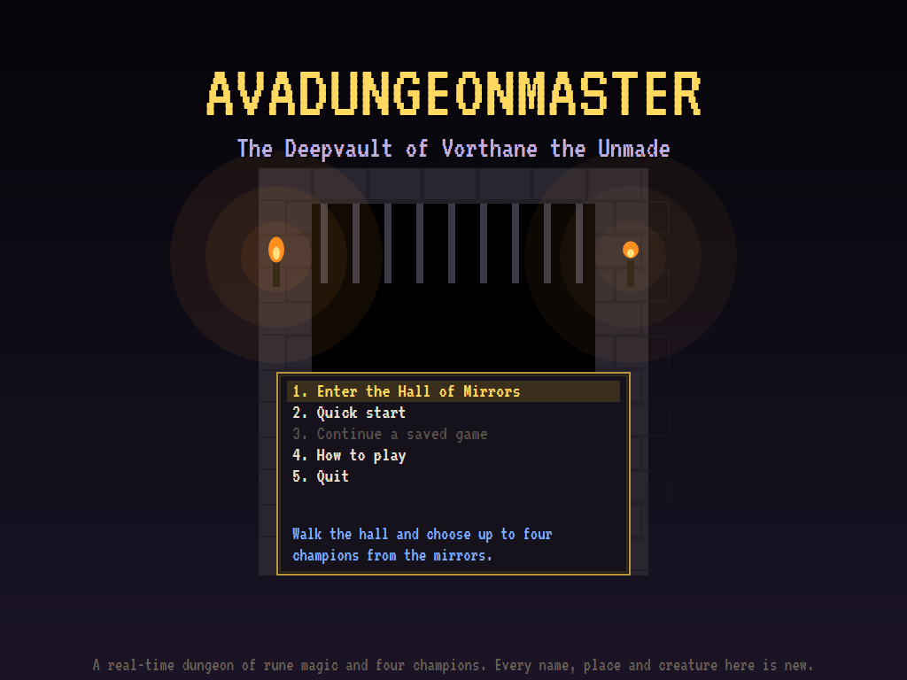 | 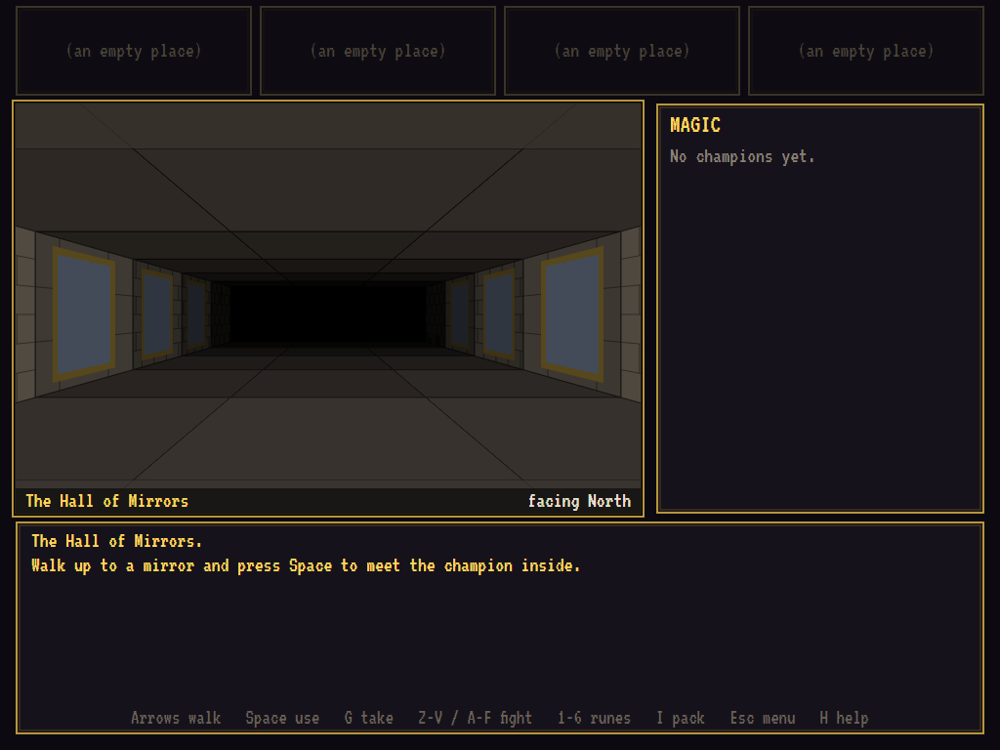 | 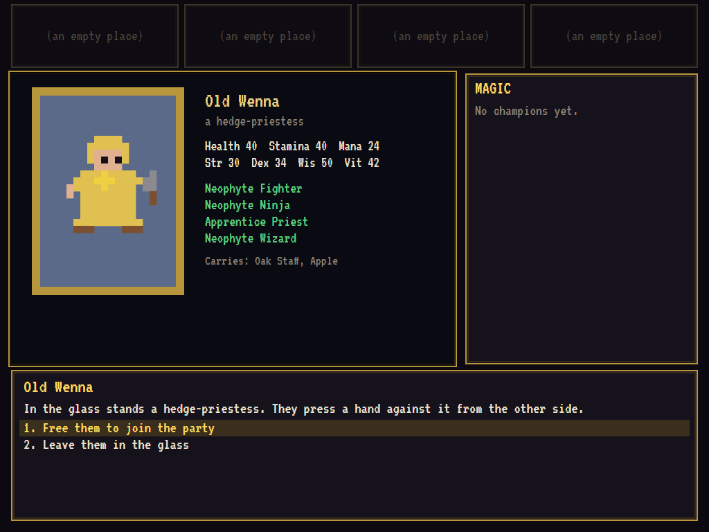 |
| Into the Deepvault. | Twelve mirrors. | Old Wenna, hedge-priestess. |

| The Gatehalls | A fight | Speaking runes |
|:-------------:|:-------:|:--------------:|
| 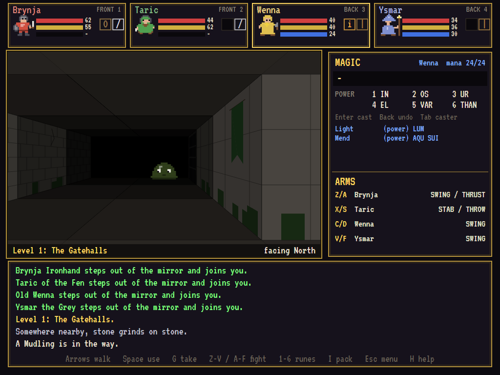 | 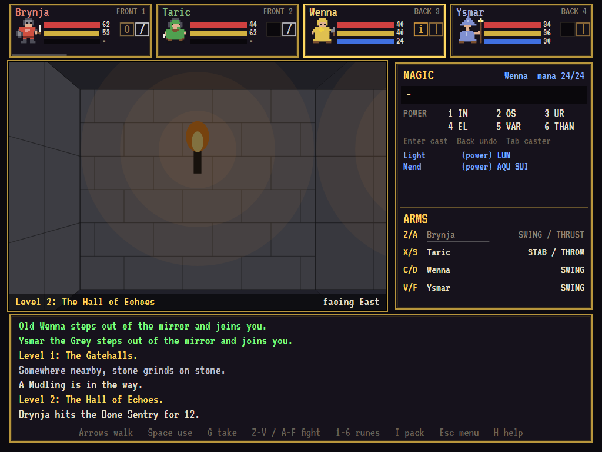 | 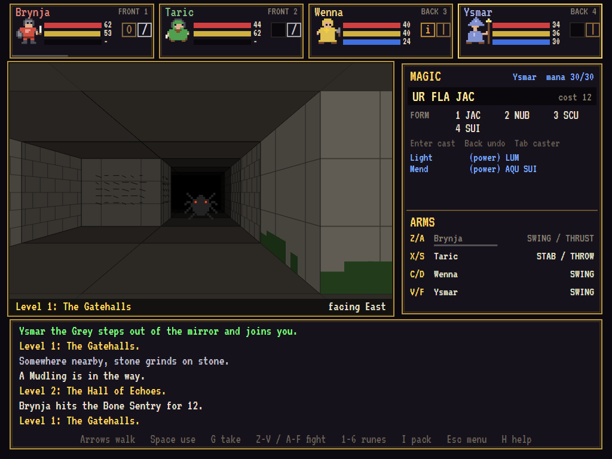 |
| A mudling in the torchlight. | Brynja against a bone sentry. | UR FLA JAC... |

| ...a fireball | The Drowned Cistern | The Forge of Ash |
|:-------------:|:-------------------:|:----------------:|
| 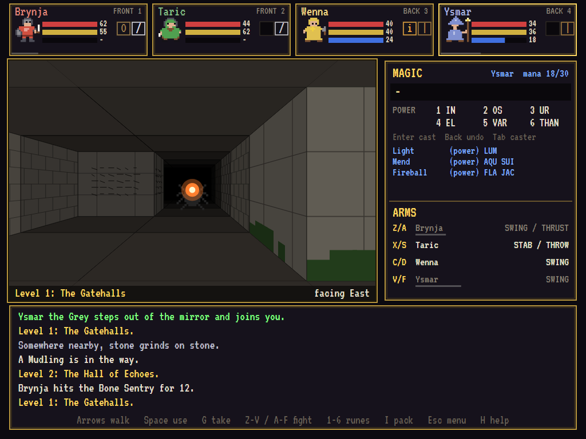 | 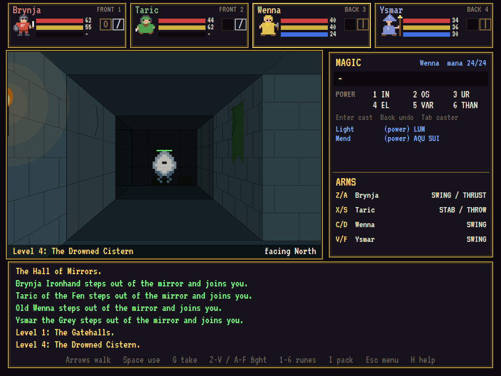 | 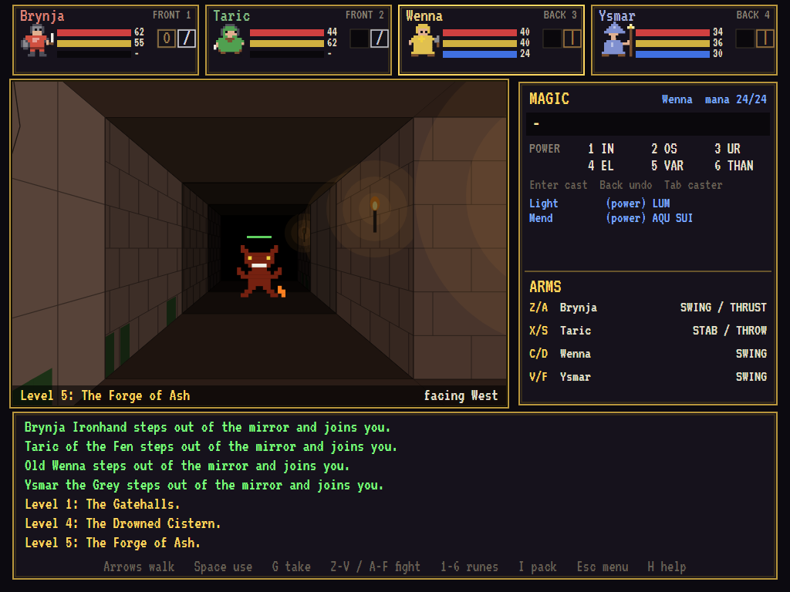 |
| ...at a crawler. | A wisp: only magic will do. | An ember imp. |

| The Deepwyrm | Vorthane, bound | A champion's pack |
|:------------:|:---------------:|:-----------------:|
| 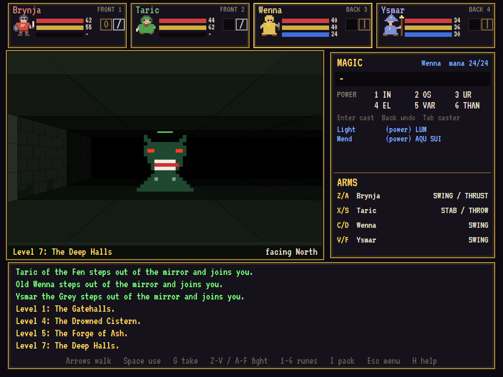 | 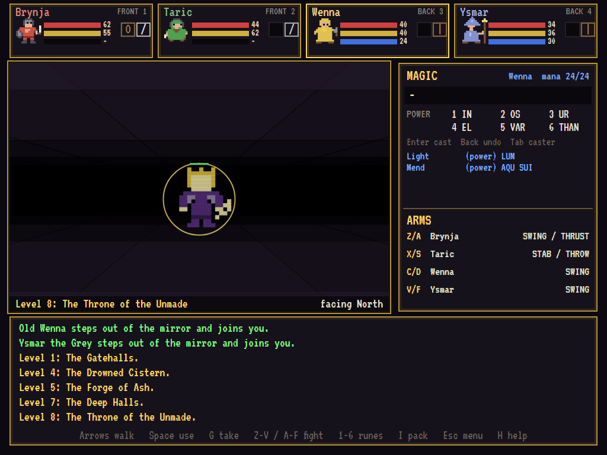 | 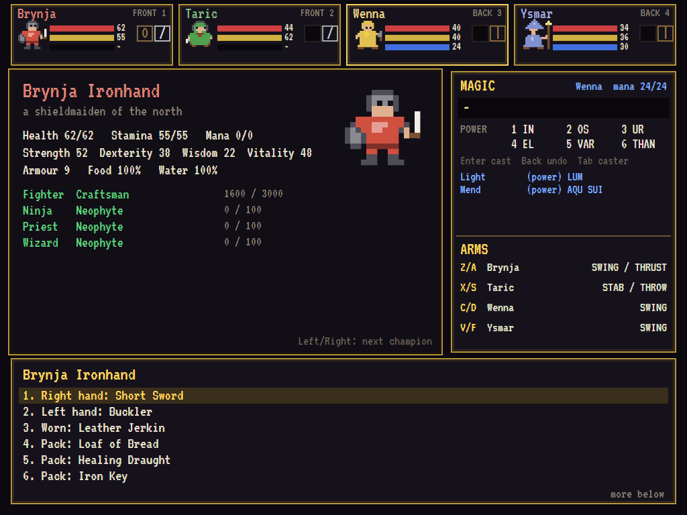 |
| It guards the Starheart. | Held by the Starheart. | Skills, kit and food. |

The screenshots are made by the tests, which play the game in a real (headless) window; see
[Tests](#tests).

## Download and run

Ready-to-run builds for Windows, macOS and Linux, on both Intel/AMD and ARM, are on the
[Releases page](https://github.com/Harlock123/AVADungeonMaster/releases/tag/latest). **Latest build**
is rebuilt on every push to `main`. Each download is one self-contained executable: no .NET install is
needed.

| Platform | Archive |
|---|---|
| Windows | `AVADungeonMaster-win-x64.zip`, `AVADungeonMaster-win-x86.zip`, `AVADungeonMaster-win-arm64.zip` |
| macOS | `AVADungeonMaster-osx-arm64.tar.gz` (Apple silicon), `AVADungeonMaster-osx-x64.tar.gz` (Intel) |
| Linux | `AVADungeonMaster-linux-x64.tar.gz`, `AVADungeonMaster-linux-arm64.tar.gz`, `AVADungeonMaster-linux-arm.tar.gz` |

```bash
tar -xzf AVADungeonMaster-linux-x64.tar.gz     # or linux-arm64, linux-arm, osx-arm64, osx-x64
./AVADungeonMaster
```

On Windows, unzip and run `AVADungeonMaster.exe`. On macOS, if Gatekeeper refuses to open it, run
`xattr -d com.apple.quarantine AVADungeonMaster` once. Run with `--no-audio` for silence.

**Sound** comes through OpenAL Soft, built in for every platform. In a virtual machine the game
detects it and uses a larger audio buffer, so the sound doesn't break up.

**Saved games** are kept in an `AVADungeonMaster` folder in your application-data folder (`~/.config`
on Linux, `%APPDATA%` on Windows).

## Controls

| Key | Action |
|-----|--------|
| **Up** / **Down** | Walk forward / back |
| **Left** / **Right** | Turn |
| **Q** / **E** | Step sideways |
| **Space** | Use what's in front: a door, a button, a fountain, an altar, a mirror, writing |
| **G** | Pick up what's lying where you stand |
| **Z X C V** | Champions 1–4 use their weapon |
| **A S D F** | Champions 1–4 use their weapon's second action (thrust, throw...) |
| **Tab** | Choose who speaks the runes |
| **1**–**6** | Speak a rune from the row shown |
| **Enter** / **Backspace** | Cast / take back a rune |
| **I** | A champion's pack (Left/Right for the next): hold, wear, eat, drink, read, give, drop |
| **Esc** | The menu: save, load, help, quit (the dungeon waits) |
| **H** | How to play |
| **F2** | Sound on and off |
| **Ctrl+S** / **Cmd+S** | Save a screenshot to the Pictures folder |

## Tests

```bash
dotnet test AVADungeonMaster.slnx
```

The game runs on a fixed 60 Hz clock with no UI beneath the screen, and keys arrive by name, so the
tests play it just as a person does. They check:

- **The dungeon**: every level closed and complete, everything placed on it real and on the floor,
  every lock with its key, every gate with its plate or button, and every writing with its words.
  A solver proves each level can be finished and that each one needs its key or switch.
- **The hall**: twelve mirrors for twelve champions, and choosing them. The stairs refuse an empty
  party.
- **Getting about**: walls, doors, plates and gates, buttons, locked doors that use up their key,
  picking up and putting down, stairs, pits, teleporters and fountains.
- **Staying alive**: hunger and thirst, torches burning out, eating from the pack, a ward halving
  blows, the fallen dropping their kit, the altar bringing them back, and losing the game.
- **Fighting and magic**:
  - **Weapons**: cutting a creature down and learning from it, the back row throwing instead of
    stabbing, and spirits shrugging off ordinary blades.
  - **Creatures**: closing in and striking the side they come from.
  - **Runes**: a fireball, mana spent on nonsense, light letting the party see further, Mend, and
    Unseal.
  - **The end**: binding and unmaking Vorthane for the victory.
- **The rest**: saving and loading the whole dungeon, the attract demo (which must never touch the
  saved games), and every sprite and sound.

The screenshot tests draw the real screen in a headless window. To refresh the README's pictures:

```bash
DUNGEON_SHOTS=$PWD/Images dotnet test tests/AVADungeonMaster.Tests --filter ScreenshotTests
```

## Building

```bash
dotnet build AVADungeonMaster.slnx
dotnet run --project src/AVADungeonMaster
```

Needs the .NET 10 SDK. The sounds are made by `tools/make_sounds.py` (standard-library Python):
`python3 tools/make_sounds.py` rewrites `src/AVADungeonMaster/Sounds`.

## Project structure

```
AVADungeonMaster/
├── AVADungeonMaster.slnx
├── src/AVADungeonMaster/
│   ├── Rules/                   # Champions and their skills, items and weapon actions, runes and
│   │                            # spells, creatures, dice
│   ├── World/                   # The levels (maps, items, creatures, locks, switches, teleporters,
│   │                            # writing), the twelve champions, the saved world, save slots
│   ├── Game/
│   │   ├── GameEngine.cs        # The clock, panels and keys
│   │   ├── GameEngine.Party.cs  # Walking, using things, stairs, pits, light, hunger, fighting
│   │   ├── GameEngine.Creatures.cs  # How creatures hunt, wander and strike
│   │   ├── GameEngine.Magic.cs  # Runes and spells, projectiles, clouds
│   │   ├── GameEngine.Menus.cs  # The title, the mirrors, packs, saving, help, defeat and victory
│   │   ├── DemoPilot.cs         # The attract demo's party
│   │   └── SoundManager.cs      # Ambience and effects through OpenAL
│   ├── Audio/                   # The OpenAL engine (from the author's AVABand)
│   ├── Views/                   # The first-person view, the champions, magic and arms panels, sprites
│   └── Sounds/                  # The synthesised effects and tunes
├── tests/AVADungeonMaster.Tests/   # World (with the level solver), gameplay and screenshot tests
├── tools/make_sounds.py
└── Images/                      # Screenshots
```

## About and licence

AVADungeonMaster © 2026 Lonnie Watson, under the [MIT License](LICENSE).

*Dungeon Master* © 1987 FTL Games; the name belongs to its current owner. AVADungeonMaster is an
independent, unofficial game in the general style of real-time dungeon crawlers. Its dungeon,
champions, creatures, rune language, story, graphics, sounds, tunes and code are its own; nothing is
taken from that game. It is not affiliated with or endorsed by any rights holder.
